# OPREL — Complete Usage Guide

Run Large Language Models Locally - With Studio, API & Cloud Integration  
**Version 0.7.2**

Oprel is a high-performance Python library and local AI platform for running large language models (LLMs) and multimodal AI entirely on your own hardware. It provides a curated model registry, a modern web interface (Oprel Studio), a developer API, native audio speech synthesis/transcription, vision-based OCR, image generation, a RAG-powered knowledge base, and support for external cloud providers — all in a single self-contained runtime.

Install: `pip install oprel==0.7.2` | PyPI: https://pypi.org/project/oprel/0.7.2/

---

## 1. Getting Started

### Installation
Oprel requires Python 3.10+ and is distributed via PyPI. Install it with:

```bash
pip install oprel==0.7.2
```

### System Requirements & Hardware Acceleration
Oprel runs cross-platform on Linux, macOS, and Windows. It automatically detects and binds to your available hardware acceleration:
- **NVIDIA GPU**: CUDA 11/12 with automated cuBLAS / cuDNN offload.
- **Apple Silicon**: Metal Performance Shaders (MPS) unified memory execution.
- **AMD GPU**: Vulkan / ROCm acceleration.
- **CPU Fallback**: Multi-threaded AVX2 / AVX-512 vectorization.

For detailed deployment and hardware allocation guidelines, see the [Hardware & Deployment Guide](docs/external/hardware_guide.md) and [Safe Installation & Deployment Guide](docs/external/install_hardening.md).

### Launching Oprel Studio (Web UI)
Oprel Studio is the unified browser interface for chatting with models, managing your knowledge base, generating speech and images, performing document OCR, and monitoring system telemetry. Start it with a single command:

```bash
oprel start
```

This launches the local server and opens Oprel Studio in your default browser at `http://localhost:11435`.

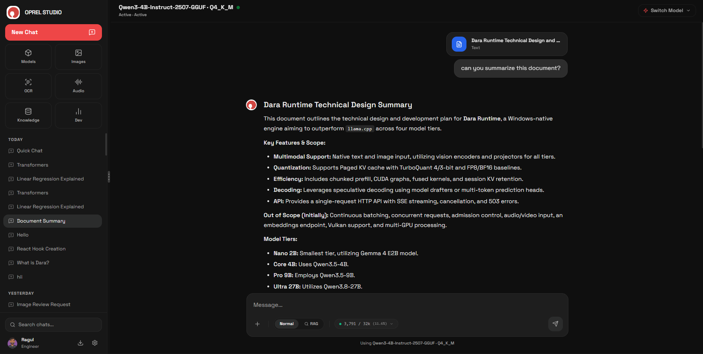

### Studio Navigation
- **Chat** — conversational LLM interface with Artifacts Canvas, system skills, and RAG context injection
- **Audio** — Kokoro-82M text-to-speech synthesis and Faster-Whisper real-time microphone transcription
- **OCR** — Dots OCR Vision Language Model (`dots.ocr-GGUF`) document extraction with 5-view workbench
- **Images** — text-to-image synthesis powered by local `stable-diffusion.cpp`
- **Knowledge** — universal multi-format document viewer with recursive semantic chunking and RRF hybrid retrieval
- **Models** — curated visual model registry with quantization profiles and one-click downloads
- **Dev** — live TPS, VRAM/RAM telemetry, latency distributions, and OpenAI-compatible API endpoints

---

## 2. System Architecture

Oprel is built as a multi-tier local runtime designed for minimal latency, strict data privacy, and optimized memory efficiency:

```mermaid
flowchart TD
    subgraph ClientLayer["1. Client & Interface Layer"]
        WebUI["Oprel Studio (Next.js 14 / React SPA)"]
        CLI["Oprel CLI (run, serve, vision, gen, pull)"]
        PySDK["Python SDK (from oprel import Model)"]
        ThirdParty["OpenAI-Compatible Clients (/v1/chat/completions)"]
    end

    subgraph ServerLayer["2. Gateway & FastAPI Server (:11435)"]
        Router["FastAPI REST & SSE Streaming Gateway"]
        DB[(Local SQLite: chat_history.db)]
        StateManager["Model State & Hardware Preflight Supervisor"]
    end

    subgraph StudioEngines["3. Specialized Studio Engines"]
        ChatEngine["Chat & Reasoning Engine\n(KV Cache Q4/Q8, Prompt Caching, Context Compactor)"]
        AudioEngine["Audio Studio Engine\n(Kokoro-82M TTS + Faster-Whisper STT)"]
        VisionEngine["OCR & Vision Engine\n(Dots OCR GGUF + mmproj VLM)"]
        ImageEngine["Image Studio Engine\n(stable-diffusion.cpp)"]
        KnowledgeEngine["Knowledge & RAG Engine\n(Semantic Chunker + RRF Hybrid Fusion)"]
    end

    subgraph ExecutionLayer["4. Native Execution Backends"]
        LlamaServer["llama-server Runtime (GGUF Backing)"]
        SDServer["sd.exe (Stable Diffusion Engine)"]
        AudioWorkers["PyTorch / CUDA Audio Workers"]
        VectorStore["Hybrid Index (ChromaDB + SQLite FTS)"]
    end

    subgraph HardwareLayer["5. Hardware Acceleration Layer"]
        CUDA["NVIDIA CUDA"]
        Metal["Apple Metal (MPS)"]
        Vulkan["AMD Vulkan / ROCm"]
        CPU["Optimized CPU (AVX2 / AVX-512)"]
    end

    ClientLayer --> ServerLayer
    ServerLayer --> StudioEngines
    StudioEngines --> ExecutionLayer
    ExecutionLayer --> HardwareLayer
```

### Architectural Highlights
1. **Zero-Overhead Gateway**: The core daemon hosts an asynchronous FastAPI server on port 11435, providing both standard REST endpoints and Server-Sent Events (SSE) for token-by-token streaming.
2. **Dynamic Layer Offloading**: Evaluates available GPU VRAM before loading each model and automatically splits transformer layers between GPU and host RAM.
3. **KV Cache Quantization**: Configurable `Q4_0` and `Q8_0` key-value cache quantization cuts context VRAM overhead by up to 50–70%, allowing long context windows even on constrained consumer GPUs.
4. **Prompt Caching & Context Compaction**: Automatically identifies and caches matching prefix token trees between turns, eliminating re-evaluation latency in multi-turn chats. Long histories are dynamically compacted to avoid out-of-memory crashes.

---

## 3. Specialized Studios

### 3.1 Audio Studio (TTS & STT)
The Audio Studio integrates two state-of-the-art speech systems into a unified local audio workstation:

- **Kokoro-82M Text-to-Speech (TTS)**:
  - Generates natural, fluid human speech directly on local GPU or CPU.
  - Multi-voice selection covering American and British regional accents (`Heart`, `Sarah`, `Bella`, `Adam`, `Michael`, `Emma`, `George`).
  - High-capacity synthesis buffer handling up to 100,000 characters per job.
  - Dynamic playback speed controls (0.5x to 2.0x) and automatic audio normalization.

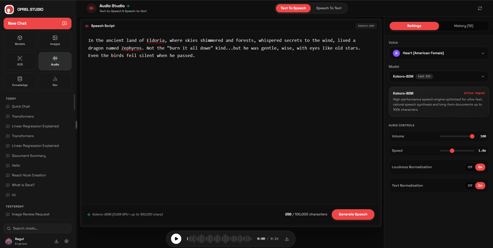

- **Faster-Whisper Speech-to-Text (STT)**:
  - Real-time live microphone transcription with streaming audio chunk capture.
  - Multi-format file audio transcription (`.wav`, `.mp3`, `.m4a`, `.ogg`, `.webm`).
  - Zero-latency warm daemon pooling to eliminate cold-start lag.
- **Interactive Waveform Player**: Visual audio timeline with interactive scrubbing, speed multiplier, and one-click `.wav` audio export.

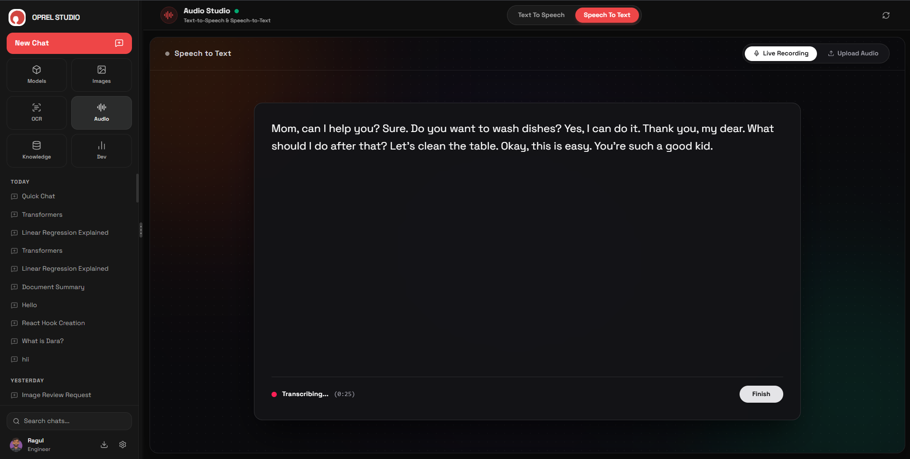

---

### 3.2 OCR & Vision Studio (Dots OCR VLM)
Oprel features a built-in Optical Character Recognition and Vision Language pipeline powered by the **Dots OCR Engine (`dots.ocr-GGUF`)** paired with multi-modal vision projection (`mmproj-dots.ocr`).

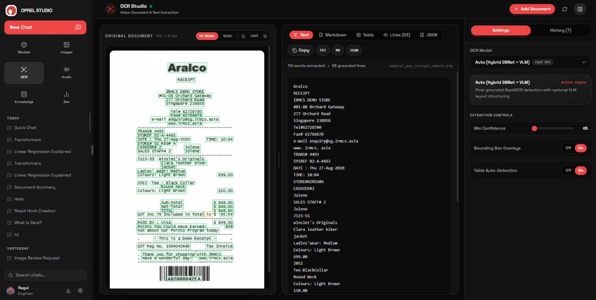

- **5-View Extraction Workbench**:
  - **Text**: Formatted text extraction.
  - **Markdown**: Formatted document view with auto-detected headings, bullet lists, and paragraphs.
  - **Table**: Structured tabular extraction for receipts, invoices, and financial records.
  - **Lines**: Line-by-line bounding box coordinates and confidence levels.
  - **JSON**: Full raw programmatic output containing coordinates, text tokens, and metadata.
- **Visual Canvas**: Side-by-side workspace with zoom, rotate, pan, and real-time bounding box inspection overlays.
- **Settings & History**: Adjustable confidence threshold sliders, bounding box toggles, and filterable session history.

---

### 3.3 Knowledge Studio & Universal Viewer
The Knowledge Studio is an enterprise-grade document ingestion and retrieval system:

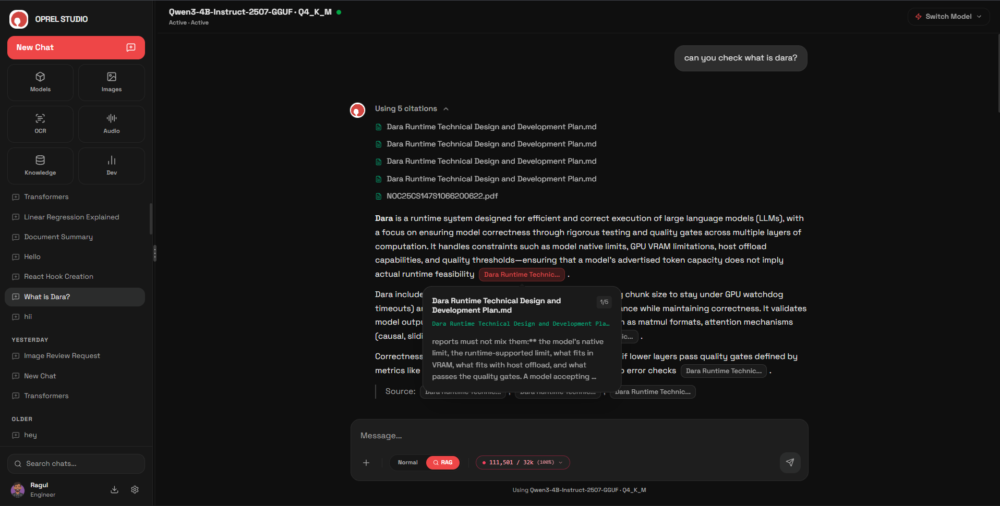

- **Universal Multi-Format Document Viewer**:
  - **Visual PDF Viewer**: Native interactive PDF viewing directly inside the modal with multi-page scrolling, zoom, and print capabilities.
  - **Tabular Data Grid**: Interactive CSV and TSV preview with sticky headers, zebra striping, and cell search filtering.
  - **GitHub-Flavored Markdown**: Rendered Markdown preview with formatted tables, blockquotes, and code blocks.
  - **Source Code Container**: Syntax-highlighted monospace viewer with line numbering for Python, TypeScript, JavaScript, SQL, HTML, JSON, YAML, and Shell scripts.
  - **Document Reader Layout**: Formatted plain text reader with real-time character/word counts, line statistics, and estimated reading times.
- **Recursive Semantic Chunker (`SemanticChunker`)**:
  - Hierarchical splitting respecting Markdown headers (`##`, `###`), paragraph boundaries (`\n\n`), and sentence terminations.
  - Target chunk capacity of 400 characters with 80-character rolling overlap and automatic heading context inheritance.
- **Hybrid Retrieval & RRF Fusion**:
  - Reciprocal Rank Fusion combining dense semantic embeddings (ChromaDB / HNSW) with sparse lexical search (SQLite FTS / BM25).
  - Context deduplication and reranking for high-precision retrieval during RAG chat sessions.

---

### 3.4 Image Generation Studio
Oprel integrates `stable-diffusion.cpp` as its local image synthesis backend:

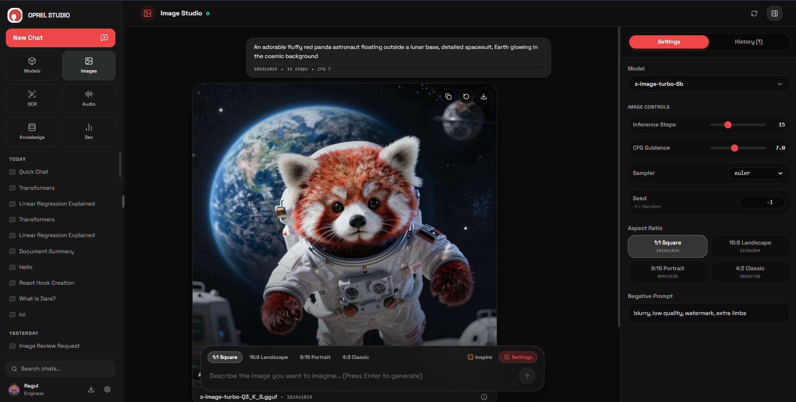

- **Prompt Studio**: Configure positive prompts, negative prompts, sampling steps, CFG scale, and generation seeds.
- **Canvas Presets**: Flexible output resolutions (512×512, 768×768, 1024×1024, landscape, and portrait).
- **Session Gallery**: Persistent history drawer displaying renders with generation parameters and one-click image export.

---

### 3.5 Artifacts Canvas
When chatting with a model, asking for code, diagrams, or web components activates the **Artifacts Canvas** — a side-by-side workspace docked next to your chat:

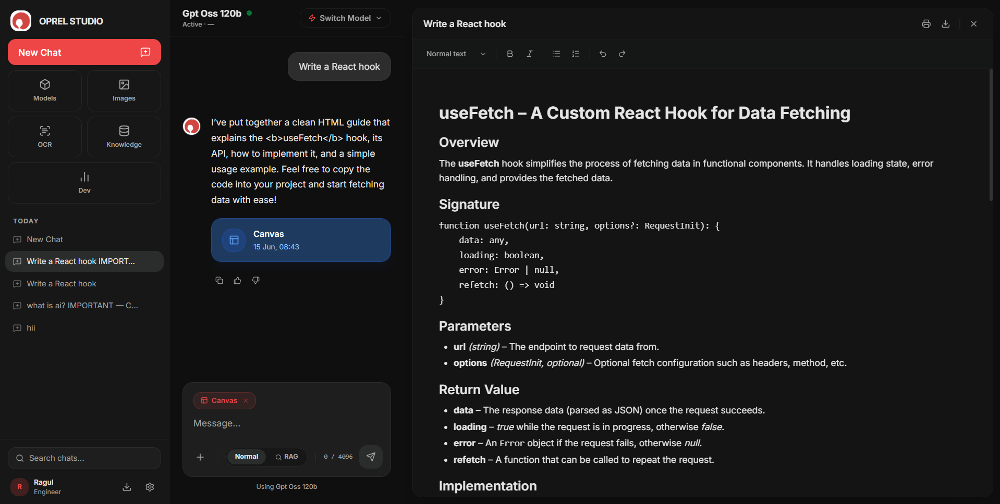

- **Code & Preview Split**: Inspect raw source code alongside rendered interactive outputs.
- **Live HTML / Tailwind CSS**: Real-time rendering of UI components, interactive forms, and prototypes.
- **Mermaid Diagrams**: Automatically compiles Mermaid syntax into clean SVG flowcharts, sequence diagrams, and class diagrams.

---

## 4. Command-Line Interface (CLI)

Oprel provides a comprehensive set of command-line tools for running, downloading, and inspecting models.

### Running a Model
```bash
# Single-shot mode: loads model, generates response, and unloads
oprel run gemma3-1b "Explain gradient descent in simple terms"

# Interactive continuous chat session
oprel run gemma3-1b
```

### Persistent Background Server
```bash
# Start the background daemon to keep models warm in memory
oprel serve

# Subsequent runs execute with zero cold-start delay
oprel run gemma3-1b "Hello!"
```

### Vision & Multimodal Inference
```bash
oprel vision qwen3-vl-7b "Describe the contents of this image" --images photo.jpg
```

### Image Generation
```bash
oprel gen "A futuristic city skyline at sunset, cinematic lighting"
```

### Model Management
```bash
# Pull model directly to local cache
oprel pull qwen2.5-coder-1.5b

# Launch Studio WebUI
oprel start
```

---

## 5. Python API & Developer Gateway

### Programmatic Python SDK
```python
from oprel import Model

# Automatically selects optimal hardware tier and quantization
model = Model("gemma3-1b")

response = model.generate("Write a quicksort implementation in Python")
print(response)
```

### OpenAI-Compatible REST Endpoints
When the server is running (`oprel serve` or `oprel start`), Oprel exposes OpenAI-compatible `/v1` endpoints. Point any third-party tool, IDE extension (e.g. Continue, Cline), or SDK directly at your local machine:

```python
import openai

client = openai.OpenAI(
    base_url="http://localhost:11435/v1",
    api_key="oprel"  # Any string
)

response = client.chat.completions.create(
    model="gemma3-1b",
    messages=[{"role": "user", "content": "Explain async/await in Python."}]
)
print(response.choices[0].message.content)
```

### Dev Telemetry Dashboard
The **Dev** tab in Oprel Studio provides live system telemetry:
- Real-time CPU usage, RAM utilization, and GPU VRAM consumption.
- Inference performance tracking in tokens per second (TPS).
- Latency distribution and token throughput volume charts.

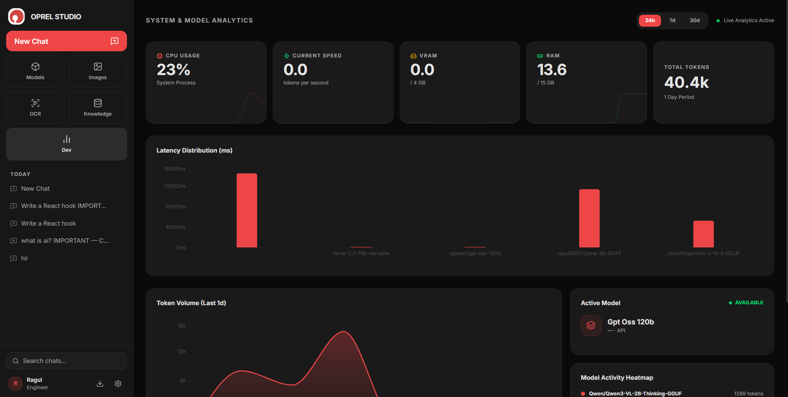

---

## 6. Model Library & Quantization

The **Models** tab provides a visual registry of available open-weights LLMs:

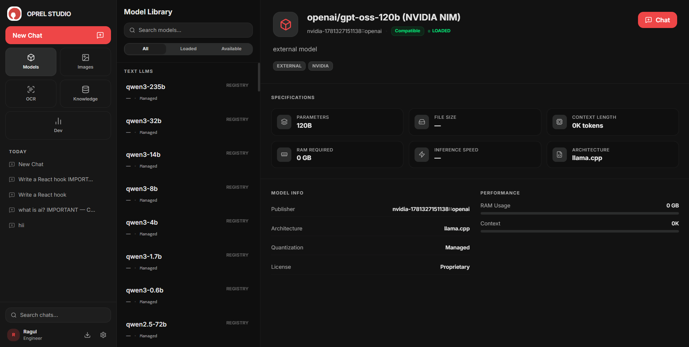

- **Quantization Intelligence**: Clear indicators for `Q4_K_M`, `Q5_K_M`, and `Q8_0` quantizations showing their exact disk and RAM/VRAM footprints.
- **Smart Model Status**: Real-time status cards indicating whether a model is cached, downloading, or actively loaded in memory.
- **Curated Categorization**: Filter by coding models (`qwen-coder`, `deepseek-coder`), general reasoning (`gemma3`, `llama3`), and vision models (`qwen-vl`).

### 6.1 Hugging Face Integration & Authenticated Hub Access
Connect your Hugging Face account directly within Oprel Studio by entering your personal user access token (`hf_...`):

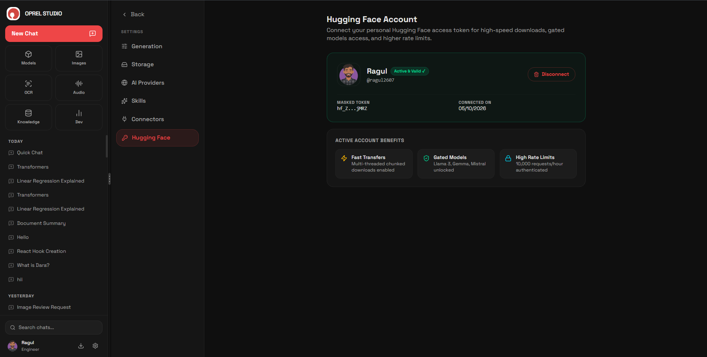

- **Gated Models Access**: Instantly download gated model weights (such as Llama 3 and Gemma) that require verified license agreements.
- **Multi-Stream Transfer**: Unlocks accelerated parallel chunk downloads from the Hugging Face Hub.
- **Token Lifecycle Verification**: In-flight token verification checks whether your credential is valid or expired, with masked display protection.

---

## 7. External AI Providers

Oprel unifies local inference with external cloud AI services. In **Settings > AI Providers**, you can configure API keys to access cloud models directly within the same chat interface:

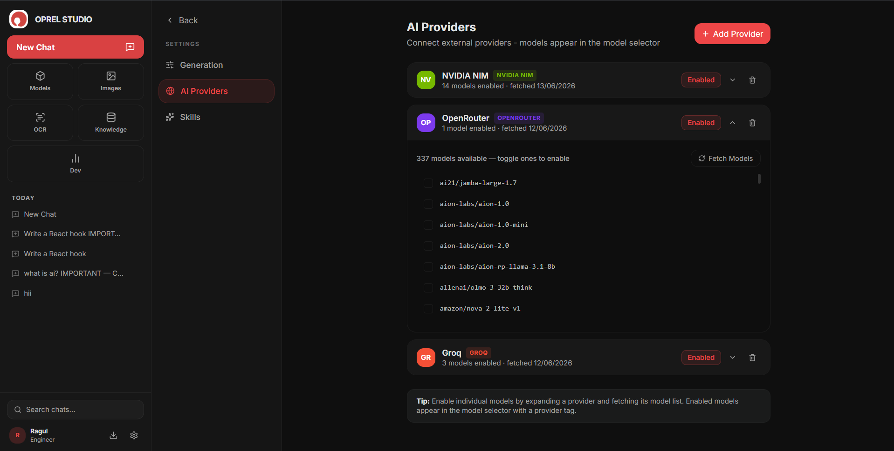

- **Google Gemini**: Gemini 2.0 Flash / Pro models.
- **NVIDIA NIM**: Accelerated cloud inference endpoints.
- **Groq**: Ultra-low latency LPU-accelerated models.
- **OpenRouter**: Access to 200+ models via a single API key.
- **Custom OpenAI**: Connect any third-party or internal OpenAI-compatible API.

---

## 8. Quick Reference & Feature Matrix

| Feature | Details |
|---|---|
| **CLI Suite** | `oprel run`, `oprel serve`, `oprel vision`, `oprel gen`, `oprel pull`, `oprel start` |
| **Python SDK** | `from oprel import Model` — high-performance generation interface |
| **OpenAI Gateway** | Full `/v1/chat/completions` and `/v1/models` compatibility at `localhost:11435` |
| **Oprel Studio** | Next.js 14 reactive workspace featuring Chat, Audio, OCR, Images, and Knowledge |
| **Audio Studio** | Kokoro-82M TTS (7 voices, 100k buffer) & Faster-Whisper STT (live mic recording) |
| **OCR Studio** | Dots OCR VLM (`dots.ocr-GGUF`), 5-view extraction (Text, MD, Table, Lines, JSON) |
| **Image Studio** | Local `stable-diffusion.cpp` synthesis with Prompt Studio and persistent gallery |
| **Knowledge Studio** | Universal viewer (PDF, CSV, Markdown, Code), Semantic Chunker, RRF Hybrid RAG |
| **Artifacts Canvas** | Interactive preview panel for Mermaid diagrams and rendered HTML / Tailwind CSS |
| **Hugging Face Hub** | Integrated token authentication modal for gated models and accelerated downloads |
| **Memory Engine** | KV Cache quantization (`Q4_0`, `Q8_0`), Prompt Caching prefix reuse, Context Compactor |
| **Cloud Providers** | Google Gemini, NVIDIA NIM, Groq, OpenRouter, and custom endpoints |
| **Telemetry** | Real-time TPS, latency, RAM/VRAM allocation, and token volume charts |

---

*Oprel — Run AI Locally, Your Way*  
[PyPI Page](https://pypi.org/project/oprel/0.7.2/)
