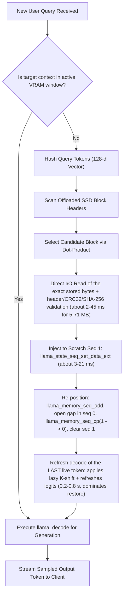

# oprel SSD KV-Cache Subsystem — Developer & Contributor Guide

> **⚠️ EXPERIMENTAL & UNRELEASED FEATURE NOTICE**  
> The SSD Key-Value (KV) cache offloading engine is an **experimental, unreleased research prototype** within the `oprel-SDK` repository (`Implement-ssd-cache` branch).  
> It is currently evaluated specifically for `unsloth/gemma-3-4b-it-GGUF` (Q5_K_M quantization) on Windows 11 with NVMe storage.  
> Review the known limitations and empirical retrieval benchmarks in Section 8 before working on this subsystem. Measured restore latency, cached-vs-uncached parity and the full limitation list are in [`ssd_kv_validation.md`](ssd_kv_validation.md).

---

## 1. Subsystem Architecture & Core Workflow

The oprel SSD engine provides tiered KV-cache management to prevent Out-Of-Memory (OOM) faults on 4GB consumer GPUs:
1. **Tier 1 (GPU VRAM)**: Maintains an active attention context window (e.g., 2,560 tokens) in low-precision `GGML_TYPE_Q4_0`.
2. **Tier 2 (NVMe SSD Storage)**: Archives evicted 512-token KV blocks to disk via unbuffered Win32 Direct I/O with 4096-byte sector alignment.
3. **Scratch-Sequence Memory Restoration**: Restores evicted KV blocks back into active GPU memory via `llama_state_seq_set_data_ext` into scratch sequence 1 followed by `llama_memory_seq_cp` to sequence 0. The block's tokens are never decoded. A restore reads the exact bytes from SSD, validates them (CRC32, model and runtime SHA-256, layer count, KV types, positions), injects them, and re-positions them; one single-token decode of the last live token then applies llama.cpp's lazy K-shift and refreshes the logits. Measured on the reference laptop: 0.66–0.80 s (Q4_0 KV) and 0.20–0.49 s (F16 KV) for 128–512-token blocks, of which about 5–70 ms is SSD read, validation and injection. The earlier `~8.2 ms / zero decode` claim is withdrawn.

### 1.1 Ingestion & Eviction Dataflow (Mermaid)

```mermaid
sequenceDiagram
    autonumber
    actor Client as Python Client / WebUI
    participant Svc as FastAPI Generation Service
    participant Nat as oprel_llama_ssd.dll (Native C++)
    participant CUDA as llama.cpp / CUDA VMM
    participant Host as Host RAM Buffer
    participant Disk as NVMe Storage (Direct I/O)

    Client->>Svc: POST /v1/chat/completions (Prompt Tokens)
    Svc->>Nat: oprel_ingest_tokens(tokens, n_tokens)
    loop Every 512 Tokens (Chunk Boundary)
        Nat->>CUDA: llama_decode(active_batch)
        CUDA-->>Nat: KV Cells Populated in seq 0
        alt Active Context > 2560 Tokens
            Note over Nat,CUDA: Safe Eviction via Scratch Seq 1
            Nat->>CUDA: drop restored blocks, apply pending K-shift (1-token decode, only if pending)
            Nat->>CUDA: llama_memory_seq_cp(mem, 0, 1, p0, p1)
            Nat->>CUDA: llama_memory_seq_rm(mem, 0, p0, p1)
            Nat->>CUDA: llama_state_seq_get_data_ext(seq 1) at live positions
            CUDA-->>Host: Serialize KV State to Host Memory Buffer
            Nat->>Disk: Win32 Direct I/O WriteFile (4KB Sector-Aligned)
            Disk-->>Nat: Block Persisted (async; a failed write marks the block unrestorable)
            Nat->>CUDA: llama_memory_seq_add(mem, 0, p1, -1, -n_discard)
        end
    end
    Nat-->>Svc: Ingestion Completed
    Svc-->>Client: Ready for Generation
```

### 1.2 Query, Retrieval & Scratch Restoration Workflow (Mermaid)



---

## 2. Component Map

The SSD KV-cache implementation is partitioned across native C++ modules, ctypes bindings, and ASGI services:

| Subsystem Layer | Relative File Path | Language | Primary Technical Responsibility |
| :--- | :--- | :--- | :--- |
| **Native Storage** | [`oprel/native/src/direct_io.cpp`](../../oprel/native/src/direct_io.cpp) | C++17 | Win32 Direct I/O handles (`FILE_FLAG_NO_BUFFERING`), `VirtualAlloc` sector alignment. |
| **Native Wrapper** | [`oprel/native/src/llama_ssd_wrapper.cpp`](../../oprel/native/src/llama_ssd_wrapper.cpp) | C++17 | Context ring buffer, scratch-sequence eviction/restore, session lifecycle. |
| **Ranker Engine** | [`oprel/native/src/quest.cpp`](../../oprel/native/src/quest.cpp) | C++17 | Experimental 128-dimensional modular token hash histogram index. |
| **Dynamic Loader** | [`oprel/native/include/llama_dyn.h`](../../oprel/native/include/llama_dyn.h) | C++17 | Runtime resolution of symbols from upstream `llama.dll`; mirrors `llama_context_params` of llama.cpp b9616 (offsets are `static_assert`ed). |
| **Structures & ABI** | [`oprel/native/include/oprel_ssd.h`](../../oprel/native/include/oprel_ssd.h) | C++17 | Versioned packed `OPREL_KV` header definition, export signatures, and runtime stats. |
| **Python Bridge** | [`oprel/runtime/backends/llama_ssd_native.py`](../../oprel/runtime/backends/llama_ssd_native.py) | Python | Ctypes declarations, lifetime management, DLL deployment, session setup. |
| **KV Storage** | [`oprel/runtime/kv_store/store.py`](../../oprel/runtime/kv_store/store.py) | Python | High-level session indexing and tier coordination. |
| **Generation Loop**| [`oprel/server/services/generation.py`](../../oprel/server/services/generation.py) | Python | Token generation loops, prefix caching, and max context handling. |
| **Tests** | [`tests/unit/test_ssd_hardening.py`](../../tests/unit/test_ssd_hardening.py), [`test_ssd_parity.py`](../../tests/unit/test_ssd_parity.py) | Python | Eviction/restore safety, corruption, caps, concurrency; cached-vs-uncached parity and K-rotation position coverage. |
| **Benchmark** | [`scripts/bench_ssd_kv.py`](../../scripts/bench_ssd_kv.py) | Python | Cold prefill, archive, warm restore and generation latency distributions. |

---

## 3. Binary Storage Layout & 120-Byte Block Header

Every archived block on SSD begins with a packed version-3 descriptor header:

```text
+-----------------------------------------------------------------------------------+
| 0x00: magic (8B, "OPREL_KV") | 0x08: version (4B, 3) | 0x0C: llama_build (4B)|
+-----------------------------------------------------------------------------------+
| 0x14: n_layer (4B, from model)| 0x18: type_k (4B, 2=Q4_0)   | 0x1C: type_v (4B)   |
+-----------------------------------------------------------------------------------+
| 0x20: p0 (4B)                | 0x24: p1 (4B)                | 0x28: n_tokens (4B) |
+-----------------------------------------------------------------------------------+
| 0x2C: state_bytes (8B)       | 0x34: checksum (4B, CRC32)   | 0x38: live start pos (4B) |
+-----------------------------------------------------------------------------------+
| Total packed struct: 120 bytes (not naturally aligned due to pack(1))               |
| 0x78 - Sector End:             Serialized KV State Tensor Payload (4KB Aligned)     |
+-----------------------------------------------------------------------------------+
```

### C++ Header Definition (`oprel_ssd.h`)
```cpp
#pragma pack(push, 1)
typedef struct OprelSSDBlockHeader {
    char     magic[8];       // "OPREL_KV" (8 bytes)
    uint32_t format_version; // 3
    uint32_t llama_build;    // 9616
    uint8_t  model_sha256[32]; // SHA-256 of model artifact
    uint8_t  runtime_sha256[32]; // SHA-256 of the loaded llama runtime DLL
    int32_t  n_layer;        // llama_model_n_layer (34 for Gemma 3 4B) (4 bytes)
    int32_t  type_k;         // KV type of the context: Q4_0 = 2 (default), Q8_0 = 8, F16 = 1 (4 bytes)
    int32_t  type_v;         // same as type_k (4 bytes)
    int32_t  p0;             // Global token index of the first token (identification only) (4 bytes)
    int32_t  p1;             // Global token index one past the last token (4 bytes)
    int32_t  n_tokens;       // Number of tokens in this block (4 bytes)
    uint64_t state_bytes;    // Exact payload size in bytes (8 bytes)
    uint32_t checksum;       // IEEE 802.3 CRC32 (4 bytes)
    uint32_t reserved;       // Live position the cells were serialised at (4 bytes) -> Total: 120 bytes
} OprelSSDBlockHeader;
#pragma pack(pop)
```

---

## 4. Win32 Direct I/O Implementation Rules

To bypass operating system file caching and prevent double-buffering in host RAM, `direct_io.cpp` requires:
```cpp
HANDLE hFile = CreateFileA(
    path,
    GENERIC_READ | GENERIC_WRITE,
    FILE_SHARE_READ,
    NULL,
    OPEN_ALWAYS,
    FILE_FLAG_NO_BUFFERING | FILE_FLAG_WRITE_THROUGH,
    NULL
);
```

### Technical Operating Constraints
1. **Buffer Pointer Alignment**: Target buffers passed to `ReadFile` or `WriteFile` must be allocated on physical sector boundaries (4096 bytes) using:
   ```cpp
   void* buf = VirtualAlloc(NULL, aligned_size, MEM_COMMIT | MEM_RESERVE, PAGE_READWRITE);
   ```
2. **Transfer Length Alignment**: Byte counts must be integer multiples of 4096:
   ```cpp
   size_t aligned_len = (raw_len + 4095) & ~4095;
   ```
3. **Seek Alignment**: File offsets used in `SetFilePointerEx` must also be 4096-byte aligned.

---

## 5. Dynamic `llama.cpp` Integration Cheat Sheet

`oprel_llama_ssd.dll` dynamically binds the following upstream symbols defined in [`oprel/native/include/llama_dyn.h`](../../oprel/native/include/llama_dyn.h):

| Symbol Name | Function Pointer Type | Declaration in `llama_dyn.h` | Subsystem Function |
| :--- | :--- | :--- | :--- |
| `llama_model_load_from_file` | `fn_llama_model_load_from_file` | `llama_dyn.h:190` | Model weight loading into GPU global memory. |
| `llama_model_n_layer` | `fn_llama_model_n_layer` | `llama_dyn.h:193` | Real layer count stored in every block/session header. |
| `llama_new_context_with_model` | `fn_llama_new_context_with_model` | `llama_dyn.h:196` | Context creation and unified KV cache initialization (`n_seq_max = 2`, `kv_unified = true`). |
| `llama_get_memory` | `fn_llama_get_memory` | `llama_dyn.h:226` | Acquires unified KV memory descriptor. |
| `llama_memory_seq_rm` | `fn_llama_memory_seq_rm` | `llama_dyn.h:228` | Removes KV cells from a designated range. |
| `llama_memory_seq_cp` | `fn_llama_memory_seq_cp` | `llama_dyn.h:229` | Shares KV cells between sequence IDs. |
| `llama_memory_seq_add` | `fn_llama_memory_seq_add` | `llama_dyn.h:230` | Shifts sequence positions. **Lazy**: the K re-rotation is applied by the next `llama_decode`. |
| `llama_state_seq_get_size_ext`| `fn_llama_state_seq_get_size_ext` | `llama_dyn.h:233` | Computes serialized byte size of sequence state. |
| `llama_state_seq_get_data_ext`| `fn_llama_state_seq_get_data_ext` | `llama_dyn.h:234` | Serializes sequence state. Does **not** apply a pending K-shift. |
| `llama_state_seq_set_data_ext`| `fn_llama_state_seq_set_data_ext` | `llama_dyn.h:235` | Deserializes sequence state into a sequence. |
| `llama_sampler_accept` | `fn_llama_sampler_accept` | `llama_dyn.h:222` | Feeds output tokens to repetition penalty samplers. |

> **Struct mirror warning.** `llama_context_params` in `llama_dyn.h` must match the pinned llama.cpp build (b9616) field for field. An earlier mirror had two extra fields and no `ctx_other`, which silently misplaced writes to fields after `type_v`. `llama_ssd_wrapper.cpp` now `static_assert`s the offsets and size it relies on; re-verify against `include/llama.h` of the exact tag whenever the runtime is upgraded.

---

## 6. Build & Deployment Instructions

### Prerequisites
- Windows 11 (64-bit)
- Visual Studio 2022 (MSVC v143 with C++17)
- CMake 3.24+
- NVIDIA CUDA Toolkit 12.x / 13.x

### Compiling `oprel_llama_ssd.dll`
```powershell
cd oprel\native
mkdir build -ErrorAction SilentlyContinue
cd build
cmake .. -G "Visual Studio 17 2022" -A x64
cmake --build . --config Release
```

### Configuration (environment variables, read at context creation)
| Variable | Default | Meaning |
| :--- | :--- | :--- |
| `OPREL_SSD_KV_TYPE` | `q4_0` | KV cache type for the live window and archived blocks (`q4_0`, `q8_0`, `f16`). Part of every block/session header, so blocks never cross types. |
| `OPREL_SSD_MAX_BYTES` | 16 GiB | Cap on the append-only block file. When reached, the new range is recorded as dropped (not restorable) instead of written. |
| `OPREL_SSD_MAX_SESSIONS` | 64 | Maximum persisted session files; the least recently written are pruned with their block files. The active session is never pruned. |

### Rebuilding while a process has the DLL loaded
A running Python process (including `oprel start`) locks `oprel_llama_ssd.dll`. Rename the loaded DLL aside (for example to `oprel_llama_ssd.dll.old_<timestamp>`), rebuild, and restart the process so it loads the new build. The server only loads the DLL when it first loads a model with the SSD wrapper.

### Running the tests and the benchmark
```powershell
# Run each native test file in its own process (see Troubleshooting item 9).
.venv\Scripts\python -m pytest tests\unit\test_ssd_hardening.py
.venv\Scripts\python -m pytest tests\unit\test_ssd_parity.py
.venv\Scripts\python -m pytest tests\unit\test_session_persistence.py
.venv\Scripts\python -m pytest tests\unit\test_native_wrapper.py
.venv\Scripts\python scripts\bench_ssd_kv.py --reps 7
```

### Deploying to Cache
```powershell
Copy-Item oprel\native\build\bin\Release\oprel_llama_ssd.dll "$HOME\.cache\oprel\bin\llama_cpp\oprel_llama_ssd.dll" -Force
```

---

## 7. Troubleshooting & Debugging Playbook

The following critical issues were diagnosed and resolved during development:

### 1. In-Place Seq 0 Deserialization Purging Active Context
- **Symptom**: Calling `llama_state_seq_set_data_ext` directly into sequence 0 purges all other cells in sequence 0.
- **Root Cause**: `llama.cpp` resets the target sequence ID before applying the deserialized state blob.
- **Fix**: Always deserialize into scratch `seq 1`, then use `llama_memory_seq_cp(1 -> 0, p0, p1)` to copy cells into sequence 0, followed by `llama_memory_seq_rm(1, -1, -1)`.

### 2. CUDA VMM LIFO Assertion Failure
- **Symptom**: Runtime crashes with `ggml-cuda.cu:581: GGML_ASSERT failed`.
- **Root Cause**: In-place memory reallocation during generation disrupted the LIFO allocation tracking in `ggml-cuda`.
- **Fix**: Scratch-sequence restore isolates memory operations to pre-allocated buffers, maintaining unified memory consistency without pointer corruption.

### 3. Windows Exception `0xe06d7363` on Cross-Model Switch
- **Symptom**: Python ctypes raises `[WinError -529697949] Windows Error 0xe06d7363` when switching from a 4B model to a 1B model.
- **Root Cause**: Deserializing 34 layers into an 18-layer model throws an unhandled C++ exception across the ctypes boundary.
- **Fix**: Current archive and session formats use the model artifact SHA-256 and reject incompatible ABI or KV metadata before restoration. All C entrypoints are protected by `try { ... } catch (...)`.

### 4. Infinite Token Repetition Loops
- **Symptom**: Model generates endless repetitive phrases (e.g., repeating the same sentence 10 times).
- **Root Cause**: `llama_sampler_accept` was omitted in `oprel_generate_next_token_ex`, preventing repetition penalty samplers from updating.
- **Fix**: Call `g_llama.sampler_accept(ctx->sampler_chain, token)` on every generated token and seed prompt history into the sampler chain at initialization.

### 5. Direct I/O Win32 Handle Sharing Violation
- **Symptom**: `direct_io_open` returns `ERROR_SHARING_VIOLATION` (32) during session swaps.
- **Root Cause**: Opening a new file handle on an existing struct without releasing the previous `HANDLE`.
- **Fix**: Added `if (f->is_open) direct_io_close(f);` before opening any new file descriptor.

### 6. Lazy K-Shift Corrupts Serialized K Vectors
- **Symptom**: Restored blocks that were archived after a `llama_memory_seq_add` produce wrong logits (control-sized error in the parity tests).
- **Root Cause**: `llama_memory_seq_add` only records the shift; `llama.cpp` applies the K re-rotation at the start of the next `llama_decode`, and `llama_state_seq_get_data` does not apply it. A block serialized while a shift was pending carries K vectors rotated for the old positions.
- **Fix**: Never serialize while `ctx->shift_pending`. `apply_pending_shift` re-decodes the last live token (one single-token decode) to apply the shift. Blocks are archived at their live positions; restore re-positions them with `seq_add` and the next decode applies the rotation.

### 7. `invalid seq_id-agnostic kv cell` on Restore
- **Symptom**: `state_read_meta: invalid seq_id-agnostic kv cell` and `failed to restore kv cache` from `llama_state_seq_set_data_ext`.
- **Root Cause**: the `llama_context_params` mirror did not match llama.cpp b9616, so `n_seq_max`/`kv_unified` could not be set correctly for the scratch sequence.
- **Fix**: corrected the mirror, `static_assert`ed its offsets, and create the context with `n_seq_max = 2` and `kv_unified = true`.

### 8. Restored Cells Re-Archived Under Wrong Positions
- **Symptom**: after restoring a block and evicting again, the new block claims token indices that belong to older content.
- **Root Cause**: restored cells sit at the front of the window, which is exactly the range eviction archives next.
- **Fix**: `drop_all_restored_blocks` runs before every archive; the live positions of the remaining restored blocks are re-tracked.

### 9. `CUDA error: invalid argument` When a Second Model Is Loaded in One Process
- **Symptom**: `ggml_cuda_compute_forward: MUL_MAT failed` / `CUDA error: invalid argument` (`ggml-cuda.cu:3163`) on the first decode of a second model loaded in the same process, after the first session did a long prefill (~3900 tokens). A short first session does not trigger it.
- **Status**: **Not fixed, cause unidentified.** Reproduces with the pre-change `oprel_llama_ssd.dll`, so it is not a regression of the SSD work. Not checked against the server's model-switch path.
- **Workaround**: run each native test file in its own process (separate `pytest` invocations).

### 10. Benchmark Timings That Look Impossibly Slow or Bimodal
- **Symptom**: `archive` or `set_data` appears to take ~2 s regardless of block size, or cold-prefill samples split into fast and slow groups.
- **Root Cause**: `oprel_ingest_prompt` returns before the GPU has finished its last chunk (CUDA is asynchronous and nothing has read the logits). The next call that synchronizes (serialize, `set_data`, sample) absorbs the remaining compute.
- **Fix**: force a sync inside the timed region (read the logits after `ingest`). `scripts/bench_ssd_kv.py` does this.

---

## 8. Feature Status Matrix

| Subsystem Capability | Implementation Status | Core File | Verification Test |
| :--- | :--- | :--- | :--- |
| **Live KV Quantization (Q4_0 default; Q8_0, F16 via `OPREL_SSD_KV_TYPE`)** | **Implemented (Experimental MVP)** | `llama_ssd_wrapper.cpp` | `tests/unit/test_native_wrapper.py`, `test_ssd_parity.py` |
| **Win32 Direct I/O Engine (looped partial transfers)** | **Implemented (Experimental MVP)** | `direct_io.cpp` | `tests/unit/test_native_wrapper.py` |
| **`OPREL_KV` Header Format (v3)** | **Implemented (Experimental MVP)** | `oprel_ssd.h` | `tests/unit/test_ssd_hardening.py`, `test_session_persistence.py` |
| **Scratch-Seq KV Restore (no prefix decode; 1 single-token refresh decode)** | **Implemented and verified (Experimental MVP)** | `llama_ssd_wrapper.cpp` | `tests/unit/test_ssd_hardening.py`, `test_ssd_parity.py` |
| **Cached-vs-uncached parity (F16 at noise floor, Q4_0 KL <= 1.5e-4)** | **Verified on the reference machine** | `llama_ssd_wrapper.cpp` | `tests/unit/test_ssd_parity.py` |
| **Atomic, checksummed session files; restored-block tracking** | **Implemented (Experimental MVP)** | `llama_ssd_wrapper.cpp` | `tests/unit/test_ssd_hardening.py`, `test_session_persistence.py` |
| **Disk cap, session pruning, sanitised session IDs, per-context lock** | **Implemented (Experimental MVP)** | `llama_ssd_wrapper.cpp` | `tests/unit/test_ssd_hardening.py` |
| **128-d Token Hash Ranker** | **Experimental (Known Defect)**| `quest.cpp` | `tests/unit/test_kv_acceptance.py` (T5, T6) |
| **Second model in one process after a long prefill** | **Known defect (llama.cpp b9616 CUDA backend)** | N/A | Troubleshooting item 9 |
| **Learned Attention Ranker (Quest)**| **Planned** | N/A | Future Milestone |
| **Linux `io_uring` Storage Backend**| **Planned** | N/A | Future Milestone |
